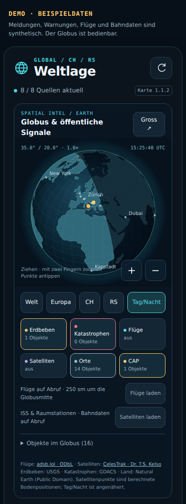

# Weltlage für Home Assistant · 1.1.2

Ein eigener Bereich für Weltinformationen: dunkle, taktische Optik, zuerst fürs Handy gebaut. Die Übersicht kombiniert ausgewählte Nachrichten mit separaten Naturereignissen und deinen bestehenden CAP-Wetterwarnungen für **Serbien / Šumadija**. Direkt darin steht ein drehbarer Globus mit öffentlichen Signalen. Die externe World-Monitor-Karte öffnet sich zusätzlich bei Bedarf.



## Neu in 1.1.2: Automatische Kartenaktualisierung

Nach einem HACS-Update **HA vollständig neu starten und Browser / Companion App neu laden**. Eine Ressourcen-URL oder Versionsnummer muss nicht mehr manuell angepasst werden.

Beim Start registriert die Integration ihre Karte selbst. Vorhandene Weltlage-Einträge (auch `/local/weltlage/weltlage-card.js` und ältere Versionsparameter) werden automatisch auf die installierte Ausgabe umgestellt. Der interne Parameter enthält Version und Dateiprüfsumme; eine neue Ausgabe erhält automatisch eine neue Adresse für den Browsercache. Nur doppelte Weltlage-Einträge werden entfernt. Andere Karten und Dashboard-Inhalte bleiben erhalten.

Die beiden JavaScript-Antworten tragen ausdrücklich `Cache-Control: no-store`. Ein älterer Query-Parameter wählt keine alte Datei aus. Bei YAML-Ressourcen wird nur die Laufzeitliste beim Start angepasst, keine YAML-Datei geschrieben. **Updates werden weiterhin über HACS installiert; bereits geöffnete Seiten benötigen danach ein Neuladen.**

## Neu in 1.1.1: Mobile Übersicht

- Kompakte Meldungen mit höchstens drei Titelzeilen. Aufklappen zeigt den vollständigen Titel und RSS-Kurztext. Der wiederholte «Medienbericht»-Badge entfällt; Hinweise auf veraltete Quellen bleiben sichtbar.
- Suche in Titel, Kurztext und Quellennamen. Alle Suchwörter müssen vorkommen. Sprache und Quelle sind separat filterbar; kombinierte Filter lassen sich mit einem Knopf zurücksetzen.
- Mehrere Themen je Artikel: Ein Angriff auf eine Ölraffinerie erscheint beispielsweise unter Konflikten und Energie. Die Zuordnung erfolgt weiterhin über Stichwörter, auch bei bereits gespeicherten Meldungen.
- Sichtbare Kartenversion, Integrationsversion unter «Quellen & Datenalter» und Hinweis bei unterschiedlichen Versionen. Dort steht auch, ob der Globus ausgeblendet wurde.
- Der World-Monitor-Dialog passt die Kartenhöhe an Kopfzeile, Hinweis und Bildschirmränder an; keine feste Höhe mit abgeschnittenem Hinweis.

[Mobile Meldungsvorschau mit synthetischen Beispieldaten](docs/mobile-meldungen.png). Der Globus ist für diese zusätzliche Vorschau über die vorhandene Option ausgeblendet.

## Neu in 1.1.0: Globus & Intel

- **Drehen und zoomen:** mit einem Finger drehen, mit zwei Fingern zoomen. «Gross» öffnet eine grosse Ansicht. Tastatur: Pfeile sowie +/−.
- **Sechs Ebenen:** Erdbeben, GDACS-Katastrophen, Flugkontakte, Satelliten, Ortsmarken und regionale CAP-Warnungen. Antippen oder über «Objekte im Globus» auswählen.
- **Flüge laden:** öffentliche ADS-B-Aufnahme von adsb.lol, 250 nautische Meilen (463 km) um die aktuelle Globusmitte. Die Mitte wird auf ein 5°-Raster gerundet; sie stammt vom Globus. Pro HA-Installation maximal eine Abfrage pro Minute. Die gestrichelte cyanfarbene Linie zeigt den abgefragten Bereich. Beim Drehen bleibt die Aufnahme aus dieser Region erhalten, bis erneut geladen wird. **Keine automatische weltweite Fluglage.** Positionen über 120 Sekunden Alter werden entfernt, ein fehlgeschlagener Abruf ist sichtbar.
- **Satelliten laden:** CelesTrak-Bahndaten für ISS und Raumstationen; maximal alle zwei Stunden. Positionen werden lokal mit satellite.js / SGP4 für die aktuelle Zeit berechnet. Ein gewählter Satellit zeigt die berechnete Bodenspur der nächsten 90 Minuten. Die Marker liegen auf der Bodenposition, ihre echte Höhe steht in den Details. Ältere Bahnepochen sind dort sichtbar; über 14 Tage alte Bahnsätze werden verworfen.
- **Tag/Nacht:** angenäherte Beleuchtungsgrenze nach UTC; Ortsmarken dienen der Orientierung. CAP-Marker für RS010 stehen an der ausdrücklich als ungefähr bezeichneten Gebietsmitte Šumadija.

Globus und Bibliotheken werden von deinem HA bereitgestellt; keine Laufzeit-CDNs, Schlüssel oder externe Globus-Bildkacheln. Die Zusatzdaten werden ausschliesslich über die Ladebuttons geholt. Canvas-Zeichnen pausiert ausserhalb des sichtbaren Bereichs oder in einem ausgeblendeten Browserfenster. Vorhandene RSS- und Naturereignis-Abrufe laufen wie bisher.

**Update auf 1.1.2:** HACS → Weltlage → ⋮ → **Erneut herunterladen**, gegebenenfalls **main** auswählen. Danach HA vollständig neu starten und Browser / Companion App neu laden. Die Ressource wird automatisch aktualisiert; oben muss «Karte 1.1.2» stehen. Der Globus erscheint automatisch, sofern `show_globe` nicht auf `false` steht.

**Home Assistant 2026.10.0 oder neuer** · Installation und Updates über HACS · keine neuen API-Schlüssel. Die Integration enthält die Dashboardkarte samt Globus und stellt beide selbst bereit. Die Veröffentlichung ersetzt keinen Live-Test in Home Assistant; Grenzen stehen in `TESTBERICHT.md`.

`VORSCHAU.html` ist eine eigenständig im Browser bedienbare Vorschau. **Alle Meldungen, Warnungen und Statusangaben darin sind Beispieldaten.** Sie zeigt dieselbe Karte wie die Installation. Nur die separat geöffnete World-Monitor-Karte kontaktiert den externen Dienst.

## Installation mit HACS

1. In **HACS → ⋮ → Benutzerdefinierte Repositories** `https://github.com/AshenSage/ha-weltlage` hinzufügen; Typ **Integration**.
2. **Weltlage** suchen und herunterladen. Falls noch kein Release existiert, die Standardbranch **main** herunterladen.
3. **Home Assistant vollständig neu starten.** Unter **Einstellungen → Geräte & Dienste → Integration hinzufügen** nach **Weltlage** suchen. Quellen wählen; Nachrichtenabruf standardmässig alle 15 Minuten, USGS/GDACS alle 5 Minuten.
4. Browser bzw. Companion App neu laden. Die Integration hat das Kartenmodul bereits automatisch registriert; kein manueller Ressourceneintrag nötig.
5. Im bestehenden Dashboard eine neue Ansicht **Weltlage** mit Layout **Panel (eine Karte)** anlegen. Eine **Manuelle Karte** hinzufügen und den untenstehenden Code einsetzen. Die eigenen bisherigen Ansichten bleiben bestehen.
6. Unter **Quellen & Datenalter** die Abrufe kontrollieren. CAP darf bei fehlenden oder veralteten Daten keine Entwarnung anzeigen.

HACS verwaltet den gesamten Ordner `custom_components/weltlage`, einschliesslich der Karte. Ein separates Kopieren nach `www` ist nicht erforderlich. Neue Versionen über HACS herunterladen, HA vollständig neu starten und Browser/Companion App neu laden. Die Integration verwaltet ausschliesslich ihren eigenen Modulressourceneintrag einschliesslich Versionsparameter. Dashboard-Konfigurationen werden nicht geschrieben.

### Manuelle Installation oder Wechsel vom ZIP 1.0.0

Manuell den enthaltenen Ordner `custom_components/weltlage` nach **`/config/custom_components/weltlage`** kopieren und HA neu starten. Danach Schritte 3–6 oben ausführen. Keine `configuration.yaml` ersetzen.

Bei einer vorhandenen manuellen Installation über HACS herunterladen bzw. erneut herunterladen. HACS übernimmt denselben Integrationsordner. Der bestehende Integrationseintrag und die Karte bleiben verwendbar. Eine alte Ressourcen-URL **`/local/weltlage/weltlage-card.js?v=1.0.0`** wird beim Start automatisch migriert. Die bisherige Kopie in `/config/www/weltlage` wird danach nicht mehr gebraucht.

```yaml
type: custom:weltlage-card
title: Weltlage
max_items: 3
alert_count_entity: sensor.cap_alerts_wmo_alert_count
alert_updated_entity: sensor.cap_alerts_wmo_last_updated
alert_areas:
  - RS010
alert_label: Serbien · Šumadija
```

Alternativ enthält `dashboard/weltlage-ansicht.yaml` die vollständige einzelne Ansicht für den Dashboard-Rohkonfigurationseditor. Diesen Block als neuen Eintrag unter `views:` einfügen und die Einrückung anpassen. `dashboard/weltlage-dashboard.yaml` ist eine vollständige Vorlage für ein **neues, separates** Dashboard.

Die Karte findet die Lagebild-Entität und den Aktualisieren-Button automatisch. Falls mehrere ähnliche Entitäten existieren oder eine andere Entität ausdrücklich gewünscht ist, `entity: sensor.weltlage_lagebild` und `refresh_entity: button.weltlage_aktualisieren` ergänzen. Die tatsächlichen IDs stehen unter Geräte & Dienste → Weltlage → Entitäten; manuelles Umbenennen kann sie verändern.

## Was enthalten ist

| Bereich | Verhalten |
| --- | --- |
| Nachrichten | SRF International, Wirtschaft und Schweiz; BBC World und Europe; RTS Serbien. Quellen sind in den Integrationsoptionen auswählbar. |
| Regionen | Welt, CH/RS, Europa, Balkan, Schweiz, Serbien. Ein Artikel kann zu mehreren Regionen gehören. |
| Themen | Politik, Konflikte, Energie/Handel, Wirtschaft, Natur, Technik. Mehrere Stichwortzuordnungen möglich; keine KI-Wahrheitsbewertung. |
| Meldungsfilter | Suchwörter in Titel/Kurztext/Quellennamen, Sprache und Quelle; mit Region, Thema und Zeitraum kombinierbar. |
| Zeiträume | 24, 48 oder 72 Stunden; höchstens 120 zusammengeführte Meldungen. Standardmässig drei sichtbar, danach «Weitere». |
| Warnungen | Vorhandene CAP-Alerts-Entitäten für `RS010`. Gelb/Orange/Rot getrennt aktiv und kommend. Grüne Einträge zählen nicht als besondere Warnung. |
| Naturereignisse | USGS-Erdbeben M ≥ 4.5 der letzten 24 Stunden; GDACS Orange/Rot. GDACS-Erdbeben werden ausgelassen, damit dieselbe Ereignisart nicht doppelt gezählt wird. |
| Globus | Lokaler drehbarer Globus mit sechs Ebenen, Details, grosser Ansicht und Tag/Nacht; Flug- und Satellitenabrufe auf Wunsch. |
| Weltkarte | Externe kostenlose World-Monitor-Einbettung für Konflikte, Erdbeben und Wetter; öffnet im Vollbilddialog. Welt/Europa/Balkan wählbar. |
| Datenqualität | Eigener Status je Quelle; gespeicherte Artikel werden bei Abruffehlern markiert. Warnstatus bei fehlenden CAP-Daten unbekannt. |
| Speicherung | Letzte erfolgreiche Quelldaten in HA `.storage`; bleiben über Neustarts erhalten. RSS-Historie höchstens 72 Stunden und 50 Einträge je Quelle. |

Meldungen bleiben in der Sprache ihrer Quelle: Deutsch, Englisch bzw. Serbisch. Der Sprachfilter zeigt ausgewählte Originalsprachen und übersetzt nicht. Kurztexte stammen aus dem RSS-Feed; vollständige Artikel öffnen beim Anbieter. Offensichtlich gleiche URLs bzw. längere identische Überschriften in engem Zeitabstand werden zusammengeführt. Ähnliche Berichte können trotzdem mehrfach erscheinen.

Die Meldungszahl zählt Einträge mit einem gültigen Veröffentlichungsdatum im gewählten Filter. Undatierte Einträge tragen «Datum fehlt» und bleiben ab ihrer ersten Erfassung höchstens 72 Stunden sichtbar. «Erfolgreicher Abruf» bedeutet, dass die Quelle erreichbar und verarbeitet wurde; der neueste Artikel kann trotzdem älter sein.

## Was sinnvoll ist

Für den Alltag sind **kurz lesbare Meldungen, nachvollziehbare Quellen, regionale Wetterwarnungen und sichtbar veraltete Daten** am nützlichsten. Weltlage bietet einen Einstieg in relevante Entwicklungen; Details lassen sich bei Bedarf öffnen. Nachrichten aus Serbien und der Schweiz sind schnell erreichbar, ohne die globale Sicht aufzugeben.

Die Karte ist im schmalen Fenster einspaltig. Ab 760 Pixel Kartenbreite stehen Nachrichten und Zusatzbereiche nebeneinander. Der lokale Globus zeigt Ereignisse räumlich; schwere externe Ansichten und zusätzliche Intel-Abfragen bleiben auf Abruf. Die Ebenen können einzeln ausgeblendet werden.

## Was nicht sinnvoll ist und hier bewusst fehlt

- **Eine globale «Gefahrenampel» aus Schlagzeilen:** dafür gibt es weder eine definierte Skala noch ausreichend vollständige Daten. Medienberichte lösen hier keine Warnung aus.
- **Automatische Alarmmeldungen für jede Weltmeldung:** zu viel Rauschen. Dieses Paket verschickt keine Push-Nachrichten und steuert keine Geräte.
- **KI-Texte als angeblich bestätigte Lage:** es gibt keine erfundenen Zusammenfassungen, automatischen Übersetzungen oder Behauptungen einer unabhängigen Bestätigung.
- **Den kompletten God’s-Eye-Stack in der HA-Karte:** die eigene Globus-Ansicht übernimmt ausgewählte öffentliche Datenquellen. Fotorealistische Gebäude, Schiffe mit AIS-Schlüssel oder zusätzliche Kameras brauchen eine separate Einrichtung und sind hier nicht enthalten.
- **Vollständige weltweite Abdeckung:** RSS-Auswahl, Stichwortfilter und öffentliche Daten haben Lücken. Ein leerer Filter ist keine Aussage, dass weltweit nichts passiert.

## World Monitor und God’s Eye

Die eingebaute kostenlose World-Monitor-Karte benötigt laut Anbieter keinen Schlüssel und aktualisiert stündlich. Sie erlaubt die drei genannten Ebenen. Flugzeuge, Schiffe und Satelliten sind nicht Teil dieser Einbettung. Die Karte meldet ihre eigene Datenlage; der Weltlage-Quellenstatus bewertet ausschliesslich unsere eigenen Feeds und CAP. Eine eingebettete Karte kann nach einem Ausfall einen älteren Zustand zeigen.

Das geprüfte God’s-Eye-Repository und meine Einschätzung stehen separat in **`GODS-EYE-CHECK.md`**. Der ursprüngliche God’s-Eye-Stack wird mit diesem Paket nicht installiert. Unser lokaler Globus greift ausgewählte Ideen und öffentliche Datenquellen daraus auf. Sobald du eine eigene erreichbare Installation hast, kannst du in der Karte ergänzen:

```yaml
intel_url: https://deine-intel-adresse.example
```

Dann erscheint «3D Intel öffnen». Das Beispiel ist ein Platzhalter, keine bereitgestellte Adresse. Ein auf einem anderen Rechner laufendes `localhost:4173` ist vom Handy aus nicht erreichbar.

## Anpassungen

Alle üblichen Einstellungen stehen auch im grafischen Karteneditor. Zusätzlich per YAML:

| Schlüssel | Standard | Zweck |
| --- | --- | --- |
| `region` | `world` | Startfilter: `world`, `chrs`, `europa`, `balkan`, `ch`, `rs` |
| `max_items` | `3` | Sichtbare Meldungen vor «Weitere», 1–12 |
| `compact_news` | `true` | Vorschau auf drei Titelzeilen begrenzen; aufgeklappt vollständig |
| `show_map` | `true` | World-Monitor-Schaltfläche anzeigen |
| `show_globe` | `true` | Lokalen Globus anzeigen |
| `entity` | automatische Erkennung | Lagebild-Entität explizit wählen |
| `refresh_entity` | automatische Erkennung | Aktualisieren-Button explizit wählen |
| `alert_areas` | `[RS010]` | CAP-Gebietscodes; leere Liste zeigt alle vorhandenen CAP-Gebiete |
| `alert_entities` | automatische Suche | Optional Liste bestimmter CAP-Warnentitäten |
| `alert_label` | `Serbien · Šumadija` | Name der Warnregion |
| `alert_max_age` | `90` | Minuten bis CAP als veraltet gilt |
| `intel_url` | leer | Adresse deiner optionalen God’s-Eye-Installation |

CAP-Sensoren mit HA-Zustand `unknown` sind nutzbar, wenn ihre CAP-Attribute gültig sind. Unbekannte Warnstufen, fehlende Zeitangaben oder nicht verfügbare Sensoren ergeben einen unvollständigen Warnstatus. Die Zeitzone der Anzeige kommt aus Home Assistant.

## Betrieb und Fehlerbehebung

- Integration nicht gefunden: Ordnerpfad kontrollieren; `manifest.json` muss direkt unter `/config/custom_components/weltlage/` liegen. HA nach dem Kopieren neu starten.
- «Custom element doesn't exist»: HA vollständig neu starten, Browser/Companion App neu laden und HA-Protokoll auf Weltlage-Einrichtungsfehler prüfen. Die Ressource wird automatisch angelegt.
- Globus fehlt / alte Ansicht: Oben «Karte 1.1.2» kontrollieren. HACS erneut herunterladen, HA vollständig neu starten und die Companion App vollständig schliessen und öffnen. Die Ressource wird dabei automatisch auf die aktuelle Version gesetzt. Steht die aktuelle Version da, im Karteneditor «3D-Globus anzeigen» aktivieren bzw. `show_globe: false` entfernen.
- Einzelne Quelle ausgefallen: Quellenbereich öffnen. Andere Quellen laufen weiter; letzte erfolgreiche Daten bleiben sichtbar. DNS/Internet des HA-Systems und HA-Protokolle prüfen.
- CAP «Daten prüfen»: Zähler, Letzter-Abruf-Entität und Gebietscode kontrollieren. Der rohe CAP-Zähler kann auch grüne Einträge zählen und ist daher keine Alarmzahl.
- Weltkarte leer: World Monitor muss vom Handy aus erreichbar sein. Bei eigener Content Security Policy muss die Domain für Frames erlaubt sein.
- Manueller Abruf: der Aktualisieren-Button hat mindestens 60 Sekunden Abstand. Automatische Abrufe bleiben massvoll; bei Fehlern verlängert sich das Wiederholungsintervall bis auf eine Stunde.

Die Integration erfordert für Nachrichtendaten Internetzugriff vom HA-Server. Die Weltkarte und externe Artikel benötigen Internet vom Gerät, auf dem die Karte geöffnet wird. Es werden keine Schlüssel verlangt, keine eigenen privaten Kameras eingebunden und keine Koordinaten deines Zuhauses an die Nachrichtenquellen geschickt.

Zum Entfernen Integration und Lovelace-Karte löschen, Modulressource entfernen, Weltlage in HACS entfernen bzw. ausschliesslich den Integrationsordner entfernen und HA neu starten. Der Integrationscache kann bei Bedarf über den HA-Speicher administriert werden; andere `.storage`-Dateien nicht verändern.

## Quellen und Prüfung

- [HA Custom Cards](https://developers.home-assistant.io/docs/frontend/custom-ui/custom-card/) und [DataUpdateCoordinator](https://developers.home-assistant.io/docs/integration_fetching_data/)
- [SRF RSS](https://www.srf.ch/really-simple-syndication-rss-feeds-von-srf), [BBC RSS](https://feeds.bbci.co.uk/news/world/rss.xml), [RTS RSS](https://www.rts.rs/vesti/rss.html)
- [USGS GeoJSON Feed](https://earthquake.usgs.gov/earthquakes/feed/v1.0/geojson.php), [GDACS Feed](https://www.gdacs.org/xml/rss.xml)
- [World Monitor: offizielle Embed-Dokumentation](https://www.worldmonitor.app/docs/embed-live-map)

Die genaue Prüfung und ihre Grenzen stehen in `TESTBERICHT.md`. Dieses Repository enthält ausschliesslich Quellcode, synthetische Tests, Vorlagen und Dokumentation; keine Zugangsdaten oder HA-Exportarchive. Änderungen stehen in `CHANGELOG.md`. Lizenz: MIT.

## Entwicklung

Node.js 24: `npm ci`, `npm run build`, `node scripts/preview.mjs`, `npm test` und `npm run test:dom`. Für die Browserprüfung zusätzlich `npx playwright install chromium --only-shell` und `npm run test:browser`. Python: `python3 -m unittest discover -s tests -v` (aiohttp erforderlich). `frontend_src/` enthält die Globusquelle und Natural-Earth-Landdaten. `scripts/build.mjs` bündelt die Bibliotheken in die mitgelieferte ESM-Datei; die Installation benötigt weder Node.js noch npm. Lizenzen stehen in `THIRD_PARTY.md`.
