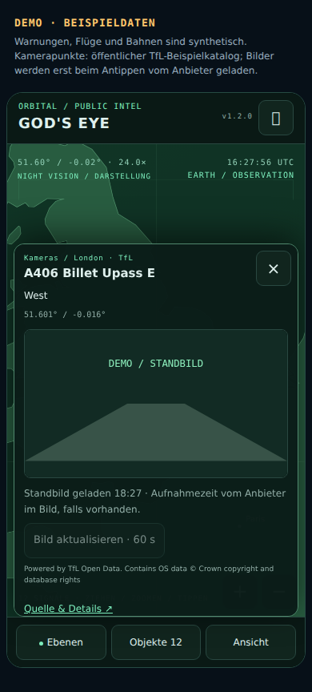

# Weltlage · God's Eye für Home Assistant · 1.2.0

Nur der Globus. Eine mobile Einsatzzentrale mit dunkler taktischer Optik, öffentlichen Verkehrskameras, Flugkontakten und berechneten Satellitenpositionen. Nachrichten, Kennzahlenkarten und die externe World-Monitor-Ansicht sind entfernt. Auch die bisherigen Nachrichtenquellen werden nicht mehr abgefragt.


## Bedienung

- **Drehen / zoomen:** ein Finger dreht, zwei Finger zoomen. +/− und Pfeiltasten funktionieren ebenfalls. Der Knopf rechts oben öffnet echtes Vollbild; die Steuerung bleibt als Schublade am unteren Rand.
- **Ebenen:** Erdbeben, Katastrophen, Flüge, Satelliten, Ortsmarken, regionale Wetterwarnungen und Kameras. Ein Objekt antippen oder über «Objekte» suchen. Dichte Kamerapunkte werden zusammengefasst; Antippen zoomt hinein.
- **Objekte:** «Im Ausschnitt» oder «Weltweit», mit Suche und Sortierung nach Entfernung, Zeit oder Name. Datenmengen und sichtbare Signale werden getrennt angezeigt; Ortsmarken zählen nicht als Signale im unteren Zähler.
- **Ansicht:** Welt, Europa, Schweiz und Serbien. Taktische Darstellung in Grün oder Cyan. «Nachtsicht» ist ein Darstellungsstil, keine Messung. Tag/Nacht ist eine angenäherte UTC-Beleuchtungsgrenze.
- **Satellitbild:** optionaler Esri-World-Imagery-Hintergrund direkt auf dem drehbaren Globus. Bilder werden erst nach Aktivierung für die sichtbare Ansicht geladen; maximal vier parallele Bildabrufe, begrenzter Speicher im Browser. Die Bildquelle bleibt auf dem Globus sichtbar. Das sind Hintergrundaufnahmen, keine Livebilder und keine 3D-Gebäude.
- Position, Zoom, aktive Ebenen und Darstellungsstil werden im Browser auf diesem Gerät gemerkt. Der 60-Sekunden-Flugmodus startet nach erneutem Öffnen ausgeschaltet.

## Verkehrskameras

Unter «Ebenen» das Kameranetz wählen, «Kameras laden» und «Zum Kameranetz» nutzen. Die erste Version enthält:

| Netz | Quelle | Bilder |
| --- | --- | --- |
| London | TfL JamCams | öffentliche, aktualisierte Standbilder |
| Finnland | Fintraffic / Digitraffic | Strassen- und Wetterkameras, mehrere Blickrichtungen |
| British Columbia | DriveBC | öffentliche Highway-Kameras |

Kataloge werden nur auf Anforderung abgefragt und pro Netz eine Stunde zwischengespeichert. Höchstens 600 Kameras pro Netz kommen in den HA-Zustand; bei grösseren Netzen sind es die nächsten zum Globuszentrum beim Abruf. Die vollständige Anzahl steht beim Katalogstatus. Nach einem fehlgeschlagenen Abruf ist ein neuer Versuch nach einer Minute möglich.

**Nur die ausgewählte Kamera lädt ein Bild.** Das originale Anbieterbild wird unverzerrt mit Quellenangabe angezeigt. Keine Bildmauer, die hunderte Kameras gleichzeitig lädt. Die Ansicht zeigt den Zeitpunkt des erfolgreichen Ladens; die Aufnahmezeit wird nur vom Anbieterbild übernommen, wenn sie dort vorhanden ist. Bei Ausfällen wird kein Ersatzbild als aktuelle Kamera ausgegeben; ein bereits geladenes Bild bleibt sichtbar. Die automatische Bildprüfung läuft nur bei sichtbarer Auswahl, entsprechend dem Netz etwa alle drei bis zehn Minuten. Manuelles Aktualisieren frühestens nach einer Minute.

Für CH und RS ist in dieser Ausgabe noch kein öffentliches Kameranetz eingebunden. NSW wurde geprüft und wegen nicht nutzbarer Anbieterbilder nicht aktiviert. Es werden keine Bilder aufgezeichnet oder im HA-Backend gespeichert.



## Flüge und Satelliten

**Flüge:** adsb.lol, 250 nautische Meilen (463 km) um die aktuelle Globusmitte. Das Zentrum wird auf ein 5°-Raster gerundet und stammt vom Globus. «Diesen Ausschnitt laden» erzeugt eine regionale Aufnahme. Beim Drehen wird eine abweichende geladene Region sichtbar; «Zur geladenen Region» führt zurück. Positionen über 120 Sekunden Alter werden entfernt. Ein optionaler **60 s ↻**-Modus lädt nur bei sichtbarer Karte nach und pausiert im Hintergrund. Der Backend-Deckel von einer Anfrage pro Minute gilt auch über mehrere Karten hinweg. Die Spur eines ausgewählten Fluges verbindet nur tatsächlich empfangene Positionen der letzten zehn Minuten.

**Satelliten:** CelesTrak-Bahndaten für ISS und Raumstationen, maximal alle zwei Stunden. Positionen werden lokal mit satellite.js / SGP4 berechnet. «ISS verfolgen» hält deren Bodenposition im Mittelpunkt; manuelles Drehen beendet das Folgen. Eine Auswahl zeigt Höhe, Bahnepoche und die berechnete Bodenspur der nächsten 90 Minuten. Bahnepochen älter als 14 Tage werden verworfen. Keine globale Echtzeitmessung aller Satelliten.

**Ereignisse:** USGS-Erdbeben M ≥ 4.5 aus den letzten 24 Stunden, GDACS Orange / Rot ohne doppelte Erdbeben; Prüfung alle fünf Minuten. CAP liest die Karte aus deiner bestehenden HA-Integration. RS010-Warnungen stehen an der ausdrücklich als ungefähr bezeichneten Gebietsmitte Šumadija, nicht am exakten Ort eines Ereignisses.

## Installation und Updates

**Home Assistant 2026.10.0 oder neuer.** In HACS als benutzerdefiniertes Repository `https://github.com/AshenSage/ha-weltlage` vom Typ **Integration** hinzufügen, herunterladen und HA vollständig neu starten. Unter Einstellungen → Geräte & Dienste die Integration **Weltlage** hinzufügen. Die Karte und ihre gebündelten Bibliotheken werden von HA bereitgestellt; keine separat installierte God’s-Eye-Anwendung nötig.

Bestehende Karten vom Typ `custom:weltlage-card` wechseln automatisch zur Globusansicht. Bisherige Nachrichtenoptionen wie `max_items`, `compact_news` und `show_map` werden ignoriert. Auch `show_globe: false` blendet den einzigen Inhalt nicht mehr aus. Alte Feed-Optionen werden nicht mehr zum Nachrichtenabruf verwendet. Der bestehende Lagebild-Sensor behält seine ID; sein Zahlenwert zählt nun Naturereignisse statt Nachrichten.

**Update:** HACS → Weltlage → ⋮ → **Erneut herunterladen**, bei Bedarf **main** auswählen. Dann **HA neu starten und die App / Browserseite neu laden**. Oben im Globus steht **v1.2.0**. Die Ressourcen-URL wird automatisch auf die installierte Ausgabe umgestellt; keine manuelle Versionsnummer oder Änderung im Ressourcenmenü nötig. Updates werden weiterhin über HACS installiert.

```yaml
type: custom:weltlage-card
title: "GOD'S EYE"
region: world
alert_count_entity: sensor.cap_alerts_wmo_alert_count
alert_updated_entity: sensor.cap_alerts_wmo_last_updated
alert_areas:
  - RS010
alert_label: Serbien · Šumadija
```

Die Lagebild-Entität wird automatisch erkannt. Optional `entity: sensor.weltlage_lagebild` setzen. `region` bestimmt die erste Ansicht; später gilt die auf diesem Gerät gemerkte Position. Die Dateien in `dashboard/` liefern eine eigene Panel-Ansicht für das bestehende Dashboard oder ein separates Dashboard.

## Vorschau und Entwicklung

`VORSCHAU.html` enthält die echte Karte samt Globus, mit synthetischen Ereignissen, Warnungen, Flügen und Bahnen. Der kleine Kamera-Beispielkatalog stammt aus öffentlichen TfL-Daten; ein ausgewähltes Bild wird direkt vom Anbieter geladen. Erst das Aktivieren von «Satellitbild» lädt Esri-Bildkacheln. Im Browser-Test werden externe Bilder durch klar gekennzeichnete DEMO-Grafiken ersetzt.

```bash
npm install
npm run build
npm run preview
python3 -m unittest discover -s tests -v
npm test
npm run test:dom
npm run test:browser
```

Eigener Code: MIT. Datenquellen und Bibliothekslizenzen: [THIRD_PARTY.md](THIRD_PARTY.md). Prüfumfang und praktische Grenzen: [TESTBERICHT.md](TESTBERICHT.md). Der Globus übernimmt Ideen von [God's Eye View](https://github.com/bilawalsidhu/gods-eye-view), ist eine eigene schlanke HA-Implementierung.
