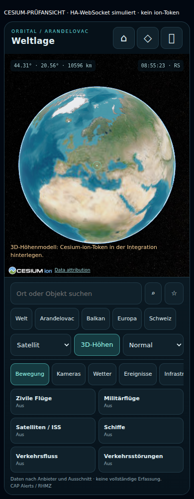
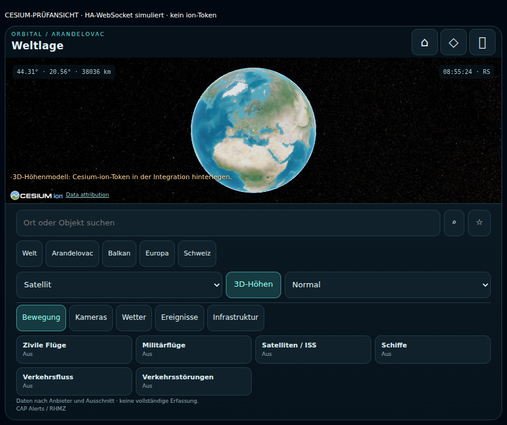

# Cesium-Rework: Prüfbericht / Fortsetzung

Stand: 12.10.2026. Ausgangsbasis `7ec0a4f` (1.2.0), Original God's Eye View `591f299`. **Aktueller Veröffentlichungskanal: normales Release 2.0.0 auf ausdrücklichen Auftrag.** Die folgenden früheren Prüfabschnitte dokumentieren den Rework; der aktuelle Veröffentlichungsstand steht am Ende. Offene Live-/Gerätenachweise bleiben offen.

## Reproduzierbare Prüfungen

- `npm run build`: Cesium-Karte, Satellite-Worker und lokale Runtime-Assets gebaut.
- `npm test`: 5 Prüfungen bestanden (Globusrahmen, Ortskoordinaten, valide Positionen, begrenzte Spur und Unterbrechung bei Beobachtungslücken).
- `npm run test:python`: 63 Prüfungen bestanden. Vorhandene Parser-/Coordinator-/Ressourcenprüfungen plus Cache-Sharing, Backoff, Datenalter, Schlüssel-/Extentzustände, Budget, Abbruch, XML-Sicherheit und neue Datenparser. Die HA-Schnittstellen sind dabei nachgebildet; das ist kein HA-Installationstest.
- Chromium 141 / SwiftShader: 20 Browserprüfungen bestanden, keine `pageerror`-Ereignisse. Breiten 320, 360, 390, 430 und 844 px; Hoch-/Querformat; kein horizontaler Seitenüberlauf; globales Zentrum; Schnellziel und Home; tatsächlicher Klick auf ein ausdrücklich synthetisches Flug-Testobjekt, Tracking und Schliessen; Zwei-Finger-Zoom; Layer ohne Schlüssel; Vollbild-Dock; Entfernen, Viewer-/Worker-Freigabe und Wiederöffnung.
- Globaler Zielpunkt nach Wiederöffnung: 44.30694025 N, 20.56000035 E. Der vollständige Globus passt mit Rand und Atmosphäre in den verfügbaren Bildbereich; geometrische Frustumprüfung plus Sichtprüfung.
- `npm run package`: vollständig gebündeltes `weltlage.zip` erstellt; Versionsgleichheit von Manifest und Build sowie erforderliche Worker-/CSS-Dateien geprüft.
- `git diff --check`: keine Whitespacefehler.

Die Browserprüfung verwendet die tatsächliche gebündelte Cesium-Karte. HA-WebSocket und Schlüssel-/Testobjektzustände sind nachgebildet. Esri-Metadaten und Kacheln werden **live** abgerufen; der Testadapter über `curl` behebt ausschliesslich die Netzwerkroute des Prüfbrowsers. Kein Testadapter ist Teil der produktiven HA-Integration. Die ersten Screenshots enthalten keine synthetischen Flugkontakte, sondern nur den echten Globus und seine Oberfläche. Die Testansicht ist oben eindeutig bezeichnet.

## Live-Datenmatrix

Diese Abrufe erfolgten in der Arbeitsumgebung, nicht auf dem Raspberry Pi und nicht im Hausnetz.

| Ebene / Quelle | Geprüfter Ausschnitt | Tatsächliches Ergebnis | Offener Nachweis / Grenze |
|---|---|---|---|
| ADS-B / adsb.lol | Serbien, Mittelpunkt nahe Aranđelovac, 250 NM | 245 bzw. beim Folgeabruf 251 valide Kontakte | Nicht das ganze sichtbare Rechteck garantiert; militärische Kennzeichnung aus `dbFlags`, keine Vollerfassung |
| CelesTrak Stationen | Globaler Katalog | 22 valide, ausreichend aktuelle Bahnelemente | Weitere Kategorien / dichter Starlink-Katalog noch nicht live geprüft |
| EMSC | Europa −25,34 bis 45,72 | 500 Ereignisse, 7 Tage, M≥1 | Ergebnislimit erreicht; nicht sämtliche Ereignisse |
| RainViewer | Europäische Sicht / globaler Framekatalog | Aktuelle beobachtete Radarframes | Regionale Stationen-/Pixelabdeckung nicht vollständig geprüft |
| NOAA globales IR | Europa 10,40 bis 30,55 | Zeitdimension gültig; echte PNG-Karte HTTP 200 | Nicht nördlich 60°; Aufnahmezeit ist nicht Abrufzeit |
| Open-Meteo Wind | Serbien | 25 valide Modellpunkte | Modell in 10 m Höhe, keine Windmessung |
| GDACS | Globaler Feed | Feed HTTP 200; 0 gültige orange/rote Meldungen im bestehenden Filter | Kein Fehler und kein Nachweis fehlender Ereignisse ausserhalb des Filters |
| TeleGeography | Globaler Kabelkatalog | 1500 geparste Linienabschnitte | Darstellung auf 1000 Objekte begrenzt, schematisch / statisch / nichtkommerziell |
| Fintraffic | Südfinnland 24,59 bis 26,61 | 238 Kamerapresets | Ergänzung für Finnland; kein Nachweis eines Schweizer/serbischen Kameranetzes |
| Esri World Imagery | Globaler Startglobe | Metadaten und echte Kacheln im Browser sichtbar | Nahansicht, Hybrid und regionale Auflösung nicht umfassend geprüft |
| OSM Kartenbasis | Weltkachel 0/0/0 | HTTP 200, PNG | Keine vollständige regionale Kachelprüfung |
| OpenTopoMap | Weltkachel 0/0/0 | HTTP 200, PNG | 3D-Terrain ist eine unabhängige ion-Quelle |
| NASA GIBS | MODIS Terra, 11.10.2026 | HTTP 200, JPEG | Tagesmosaik; keine regionale Wolkenfreiheit oder Aktualität jedes Pixels zugesagt |
| OSM Infrastruktur / Overpass | Serbien | Quelle in dieser Arbeitsumgebung nicht erreichbar; separater GET HTTP 406 | Staudämme, Rechenzentren und Militäranlagen nicht als funktionierend bestätigt |
| Windy Webcams | Geplante Tests Aranđelovac, Serbien/Balkan, Oberbipp/Schweiz, Österreich | **Nicht bestätigt** | Automatische Prüfung hat Verwendung des zuvor genannten Schlüssels blockiert; keine Trefferzahlen/Bilder als erfolgreich ausgewiesen |
| Cesium ion Terrain / Google 3D | Aranđelovac, Balkan, Schweiz | **Nicht geprüft** | Aktueller Token fehlt; Assetzugang und regionale 3D-Abdeckung müssen live geprüft werden |
| TomTom | Regionale Segmente / Störungen | **Nicht geprüft** | Schlüssel fehlt |
| Mapillary | Regionale historische Bilder | **Nicht geprüft** | Schlüssel fehlt |
| NASA FIRMS | VIIRS NOAA-20, 24 h | **Nicht geprüft** | Schlüssel fehlt |
| AISStream | Europäische Küsten / Häfen | **Nicht geprüft** | Schlüssel fehlt; Binnengewässer insbesondere Donau ohne Abdeckungsgarantie |
| CAP Alerts / RHMZ | RS010 in bestehender Karte | Parser und Darstellung vorbereitet | Aktuelle HA-Entitäten / Warnpolygone nicht aus dem Haus abgerufen |

## Freigabeblocker

1. Aktuelle sechs Zugangsdaten fehlen in dieser Sitzung; die Übernahme eines früher genannten Windy-Schlüssels wurde durch automatische Freigabeprüfung abgelehnt. Erst nach ausdrücklicher Freigabe bzw. Bereitstellung aktuelle Schlüsseltests ausführen. Schlüssel nie im Repository hinterlegen.
2. Broad-Camera-Abdeckung/Bilder für die vier verlangten Regionen sind noch nicht nachgewiesen. Es wird bewusst keine Europaabdeckung als erfolgreich behauptet.
3. World Terrain und Google Photorealistic 3D müssen mit dem tatsächlichen ion-Konto funktionieren; Token allein reicht nicht.
4. Upgrade in HA Core 2026.10.1, Config-/Optionsflow, authentifizierte WebSocket-Endpunkte und tatsächliche StaticPath-/Lovelace-Integration sind nicht in einer echten HA-Instanz getestet. Python-/Browser-Stubs ersetzen diesen Nachweis nicht.
5. Reales Android/iOS-Gerät, native Vollbild-Sonderfälle, Raspberry-Pi-Last, mehrere parallele echte Clients und länger laufende Ressourcenmessungen fehlen.
6. OSM-Infrastruktur scheitert aktuell am Quellzugang in dieser Umgebung; Ursache / geeigneter Endpunkt prüfen.

## Bewusste Grenzen des Entwurfs

- Weltweite Ortssuche fehlt; vorhanden sind geladene Objekte, Schnellziele und Koordinaten.
- Windy-Katalog maximal 50 Kameras pro Anfrage, räumliches Clustering im Browser. Eine begrenzte Liste ist keine flächendeckende Bestandsaussage.
- Verkehr ist eine reale Stichprobe von bis zu fünf TomTom-Segmenten, keine kontinuierliche komplette Strassenkarte. Die Anzeige nennt dies ausdrücklich.
- CAP zeigt das erste gültige Polygon je Warnung, sonst eine markierte Gebietsmitte.
- GIBS-Tagesdatum statt vollständiger CMR-Suche. AMSS-/Schweizer-Spezialquellen sind nicht ungeprüft ergänzt.
- Kein OSM-Buildings-Fallback, keine Cockpitansicht, keine gespeicherte letzte Kameraposition. Satelliten-/Schiffsverfolgung und vorhandene Flugspuren sind implementiert, aber nur der Flug-Testfall ist im Browser geprüft.
- Browser-Kachel-/ion-Aufrufe fallen ausserhalb des Backend-Tageslimits an. Das lokale Backend-Limit wird bei HA-Neustart zurückgesetzt und ersetzt keine Anbieterquota.
- Keine Produktionsinstallation, Freigabe oder belastbare Performancezusage aus der Desktop-SwiftShader-Prüfung ableiten.

## Nächste Schritte

1. GitHub-PR / Actions prüfen; Review-ZIP und Browserbilder aus dem Workflow verfügbar machen.
2. Schlüsseltests lokal unter ausdrücklicher Autorisierung durchführen, Resultate nur als redigierte Metadaten dokumentieren.
3. Windy-Verfügbarkeit, kurzlebige Bilder und ion-Abdeckung früh nachweisen. Bei fehlender Kameraabdeckung passende offizielle ergänzende Netze recherchieren und rechtlich/technisch prüfen.
4. HACS-Upgrade in einer echten HA-2026.10.1-Testinstanz sowie mobiles Gerät und Parallelclients prüfen.
5. Kritische Lücken schliessen; Manifest, Package und `VERSION` gemeinsam auf 2.0.0 ändern; erneut bauen/testen. Erst dann PR integrieren und einen passenden Release-Tag veröffentlichen. Release-Workflow hängt das vollständig gebündelte `weltlage.zip` an.

## Screenshots

Cesium-Prüfoberfläche mit echten Esri-Kacheln; HA simuliert, kein ion-Token. Bild-/Kartendaten © Esri und jeweilige Datenanbieter, siehe sichtbare Cesium-Datenattribution und THIRD_PARTY.md. Bildschirmaufnahmen dienen der UI-Prüfung und sind kein Nachweis einer Installation im Haus.

## Nachprüfung mit privaten Schlüsseln (12.10.2026, dev.2)

Die fünf neu gelieferten Zugangsdaten wurden ausschliesslich lokal verwendet. Weder Schlüssel noch signed Bild-/Asset-URLs stehen in diesem Bericht oder im Repository. Der früher genannte Windy-Schlüssel bleibt für Liveabrufe durch automatische Prüfung blockiert, bis seine Verwendung ausdrücklich freigegeben ist.

| Quelle | Neuer echter Nachweis |
|---|---|
| Cesium World Terrain, Asset 1 | Endpoint HTTP 200, `layer.json` HTTP 200, echter Quantized-Mesh-Tile HTTP 200 / 93.283 Bytes |
| Google Photorealistic 3D, Asset 2275207 | ion-Endpoint und tatsächlicher Google-Root-Tileset HTTP 200, Root mit vier Kindern. Regionale gerenderte Gebäudeabdeckung weiterhin nicht bestätigt |
| OSM Buildings, Asset 96188 | Endpoint und Root-Tileset HTTP 200; dient nur als Zugriffsprüfung, keine zusätzliche überlagerte Gebäudeanzeige eingebaut |
| TomTom | Vier echte Verkehrssegmente um Aranđelovac; 300 geparste Störungen im Schweizer Ausschnitt |
| NASA FIRMS | Ein echter VIIRS-NOAA-20-Hotspot im Schweizer Ausschnitt; kein bestätigter Waldbrand |
| Mapillary | Nach Begrenzung/gerundeten Koordinaten und lazy Einzelabruf jeweils 20 Positionspunkte bei Aranđelovac und Oberbipp, echte Einzelbilder HTTP 200. Beispieldaten stammen aus 2019 bzw. 2025, keine Live-Kameras |
| AISStream | 50 bzw. beim Folgeabruf 60 echte Schiffspositionen im Rotterdam-Ausschnitt innerhalb von acht Sekunden |

Gefundene und korrigierte Fehler: AISStream sendet hier JSON auch als WebSocket-Binärnachricht; nun werden Text/Binär und Class-A/Class-B-Positionsmeldungen verarbeitet. Mapillary begrenzt Ausschnitte auf 0,01 Quadratgrad und verweigerte grosse Abfragen. Der Adapter prüft die tatsächliche quantisierte Fläche vor dem Abruf, rundet Query-Koordinaten und lädt Bilder einzeln.

### Native HA-Prüfung

HA Core 2026.10.1 mit Python 3.14.8 wurde isoliert installiert. Wegen eingeschränkter Host-Interface-Erkennung im Testcontainer wurden ausschliesslich im Testharness der HTTP-Quell-IP-Resolver auf tatsächliches Loopback und DNS auf ThreadedResolver gesetzt. Keine solche Änderung ist Bestandteil der Integration oder des privaten Pakets. Das ist ein echter Core-/Integrationslauf mit umgebungsspezifischer Netzwerkanpassung, kein Test auf dem Raspberry Pi oder im Hausnetz.

Bestätigt: Komponentensetup, echter User-Configflow ohne Fehler, ConfigEntry `LOADED` mit fünf Schlüsseln, Optionsflow ohne Fehler, Reload eines Eintrags ohne gespeicherte Schlüssel aus der privaten Konfigurationsdatei, Karten-HTTP 200 mit `no-store`, Cesium-CSS HTTP 200 sowie erfolgreiche HA-WebSocket-Authentifizierung und `weltlage/config` mit fünf konfigurierten Feldern. Abschliessender Unload separat geprüft. Die vollständige HACS-Migration von einer echten bestehenden 1.2.0-Installation und reale Smartphone-Performance bleiben offen.

Die alten Matrixzeilen «Schlüssel fehlt» sind damit für diese fünf Quellen überholt. Windy-Abdeckung und regional gerendertes Google-3D sind weiterhin Freigabeblocker; keine stabile Version wurde deshalb veröffentlicht. Ein privates dev.2-Paket enthält die fünf Werte in einer separaten Konfigurationsdatei, ausserhalb des Integrationsordners. Öffentliche ZIPs enthalten keine persönlichen Werte.

## HACS-Beta-Veröffentlichung

Auf ausdrücklichen Auftrag wird der geprüfte Stand als **2.0.0-beta.1**, GitHub `prerelease: true`, mit öffentlichem, schlüsselfreiem HACS-ZIP veröffentlicht. Die offenen Nachweise werden nicht als bestanden behandelt; sie verhindern weiterhin eine stabile 2.0.0-Freigabe. Der Beta-Paketbau wiederholt Build, 63 Python-, 5 JS- und 20 Browserprüfungen vor der Veröffentlichung. Ein Draft-Release erhält zuerst das vollständige ZIP und wird erst danach sichtbar. Schlüssel werden ausschliesslich in HA eingegeben.

## Normale Veröffentlichungen ab 2.0.0

Der Nutzer verlangt ab jetzt ausschliesslich normale Releases. Daher verwenden Manifest, Package, Lockdatei und Integrationskonstante `2.0.0`; der Workflow akzeptiert nur numerische `x.y.z`-Versionen und veröffentlicht mit `prerelease: false` und «Latest». Das vollständige ZIP wird vor der Veröffentlichung angehängt. HACS benötigt somit keinen Vorabversionsschalter.

Der gemeldete Downloadfehler entstand durch `releases/download/7571422/weltlage.zip`: HACS hatte mangels normalem Release die Main-Commit-Version gewählt. Das Paket lag ausschliesslich am Beta-Tag. Das normale Release stellt nun den passenden Versions-Tag samt ZIP bereit.

Die vom Nutzer zitierte Konfigurationsbeschreibung stimmt exakt mit der Übersetzung aus 1.2.0 überein. Der neue Config-/Optionsflow enthält sechs Passwortfelder und das Abruflimit; er wurde zuvor im isolierten HA Core 2026.10.1 geprüft. Das Update erfordert einen vollständigen HA-Neustart. Es enthält keine privaten Zugangsdaten. Die Wahl des normalen Release-Kanals ersetzt keine noch ausstehenden regionalen Live-/Geräteprüfungen.

## Karten-/Token-Korrektur 2.0.1

Die Screenshot-Meldung stammt aus `Ion.getDefaultTokenCredit`. Im tatsächlich gebündelten Cesium 1.146.0 rufen `CesiumTerrainProvider.fromIonAssetId` und `Cesium3DTileset.fromIonAssetId` intern `IonResource.fromAssetId(assetId)` ohne Weitergabe der Darstellungsoptionen auf. Der bisher dort übergebene `accessToken` hatte somit keine Wirkung. Beide Pfade erstellen nun zuerst eine explizit authentifizierte `IonResource` und verwenden anschliessend `fromUrl`. Der Demo-Token wird deaktiviert.

«Karte» lädt Esri World Street Map mit Attribution aus der Dienstbeschreibung. Der öffentliche Metadatenabruf war HTTP 200 (24 Zoomstufen), und echte Strassenkartenkacheln wurden im Chromium-Globus dargestellt. Das vom Nutzer gemeldete HTTP 403 wurde ohne Netzwerkprotokoll nicht einer konkreten Anfrage zugeordnet. Die bisherige OSM-Quelle verlangt einen gültigen Referrer; die neue Basis hängt nicht mehr von deren Kacheln ab. Esri World Street Map bleibt ein Legacy-Rasterdienst (keine laufenden Updates, Einstellung Dezember 2029 laut Anbieter), keine Zusage aktueller Strassenzustände.

Lokal bestanden: fünf JavaScript-, 63 Python- und **26 Browserprüfungen**. Die sechs zusätzlichen Browserprüfungen bestätigen keine ion-Anfrage ohne Schlüssel, echte Strassenkartenkacheln ohne OSM-Anfrage, Erhalt der vorherigen Basis bei synthetischem Metadatenausfall, explizite Token-Übergabe für Terrain und Google-3D sowie keine Demo-Token-Creditmeldung. Die ion-Anfragen werden ausschliesslich mit einem synthetischen Testtoken abgefangen und mit HTTP 403 beantwortet; das prüft Authentifizierung und kontrollierte Fehlerbehandlung, keine reale Assetabdeckung. Vorherige Live-Nachweise bleiben unverändert. Das Release enthält keine persönlichen Schlüssel.
